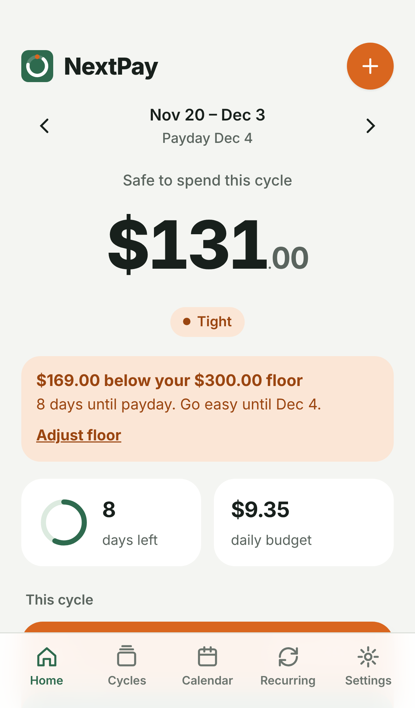
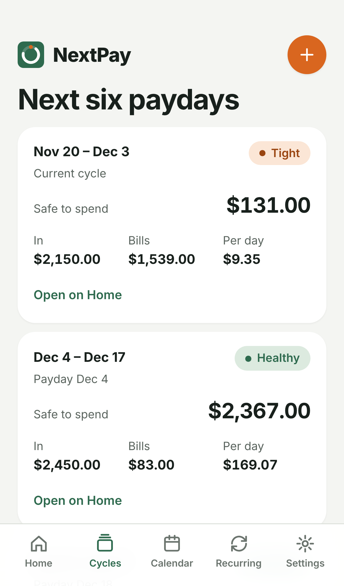
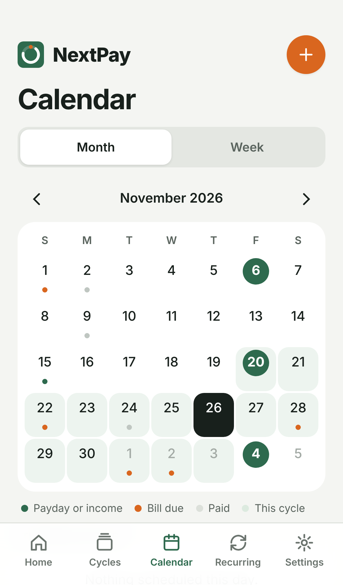

<p align="center">
  
</p>

<h1 align="center">NextPay</h1>

<p align="center"><strong>How much can I safely spend before my next payday?</strong></p>

NextPay is a personal cash-flow app built around paydays instead of calendar months. Every figure is scoped to the pay cycle you're looking at, so a tight week shows up before it arrives, not after.

It's a single-person tool you host yourself. You enter your own pay schedule, bills, income and spending. Everything is stored in one SQLite file on your server: no bank connections, no sync service, nothing sent anywhere else.

<p align="center">
  
  
  
</p>

## How it works

- **A cycle runs from one payday to the day before the next.** Weekly, every two weeks or monthly, anchored to a payday you pick.
- **Every payday restarts the math.** A surplus or shortfall never carries into the next cycle.
- **Safe to spend** is what's left of the cycle's income after the bills it has to cover. It comes with a daily budget and a plain status: *healthy*, *tight* (below your floor) or *deficit*.
- **Every number is traceable.** Tap a total to see the items that make it up.

You choose one of two tracking modes in onboarding, and can switch any time in Settings:

| Mode | Safe to spend | What you log |
|---|---|---|
| **Simple** (default) | cycle income − cycle bills − unexpected expenses | Only the big surprises, like a car repair. Bills log themselves. |
| **Ledger** | your balance + income still expected − bills still unpaid | Every purchase and deposit, starting from your real bank balance. |

## Features

- **Home:** the safe-to-spend number, days left, daily budget, a low-balance banner when you dip below your floor, and stacked cards for bills, income and spending. Step back and forth between cycles.
- **Cycles:** the next six paydays side by side, with the tight ones called out.
- **Calendar:** month and week views of every payday and bill, with paid bills marked off.
- **Recurring:** bills and extra income on a schedule (a weekday every 1 to 4 weeks, a day of the month, or every N days). Auto-pay bills mark themselves paid on their due date.
- **Settings:** pay profile, tracking mode, floor and warning, sign out, and your data: download a backup, restore one, load sample data, or start clean.
- **Installs on your phone** as a full-screen app (PWA), with an offline page instead of stale numbers when the server can't be reached.
- **Accessible:** keyboard shortcuts (`1` to `5` switch tabs, `?` opens help, `Esc` closes sheets), visible focus, status never shown by color alone, and reduced motion respected.

## Tech stack

Next.js 16 (App Router, React 19, TypeScript), SQLite with `better-sqlite3` and Drizzle ORM, Zod, Tailwind CSS 4, Motion, argon2 password hashing, a hand-written service worker, Vitest and Playwright, Biome, pnpm. It ships as one Docker image.

More detail: [PRD.md](PRD.md) is the product spec, [CLAUDE.md](CLAUDE.md) explains how the code is organised, and [docs/design/mockup.html](docs/design/mockup.html) is the approved design.

## Run it locally

You need Node 22 and pnpm 10 (`corepack enable` sets up the version pinned in `package.json`).

```bash
pnpm install
pnpm dev            # http://localhost:3000
```

The first visit opens onboarding: choose a password, then set up your pay. To try it with made-up numbers, run `pnpm db:seed` before onboarding, or use **Settings → Reload sample data** afterwards.

The database is created at `./data/nextpay.db` and migrations run on start.

| Command | What it does |
|---|---|
| `pnpm build` / `pnpm start` | Production build and server |
| `pnpm test` | Unit and integration tests (Vitest) |
| `pnpm e2e` | End-to-end tests (Playwright, iPhone viewport, port 3100) |
| `pnpm typecheck` | TypeScript check |
| `pnpm check` / `pnpm fix` | Lint and format with Biome |
| `pnpm db:generate` | Create a migration after a schema change |
| `pnpm db:seed` | Load the sample data into `DATABASE_PATH` |

## Self-hosting

NextPay is meant to run on a home server, NAS or small VPS, and be opened from your phone and computer.

### 1. Start the container

```bash
git clone https://github.com/HomieEddy/MyNextPay.git nextpay
cd nextpay
mkdir -p data && sudo chown 999:999 data
docker compose up -d --build
```

The container runs as a non-root user (uid 999), so the `data` folder must be writable by it. If the logs (`docker compose logs nextpay`) show a permission error on `/data`, the `chown` step above is the fix. To confirm the user id on your build, run `docker compose run --rm --entrypoint id nextpay`.

The app listens on port 3000. Check it's up with `curl http://localhost:3000/api/health`; Docker also runs that health check on its own.

There's no default password and no admin account. Open the app and the first visit asks you to choose a password. **Do this right away**, before exposing the app to anyone else on your network.

### 2. Configure

Set these in `compose.yaml`, or in a `.env` file next to it:

| Variable | Default | What it does |
|---|---|---|
| `TZ` | `America/Toronto` | Your time zone. It decides what "today" is, so paydays and due dates roll over at your midnight. |
| `TRUST_PROXY` | `false` | Set to `true` only when NextPay sits behind a reverse proxy. Login rate limiting (5 tries per 15 minutes) then uses the visitor's real IP from `X-Forwarded-For` instead of treating everyone as one visitor. |
| `DATABASE_PATH` | `/data/nextpay.db` | Where the SQLite file lives inside the container. You shouldn't need to change it. |

There's no secret key to generate. Session tokens are random and only their hash is stored.

### 3. Put HTTPS in front

HTTPS isn't optional. The session cookie is marked `Secure`, so browsers won't keep you signed in over plain `http://` (except on `localhost`), and phones only offer to install the app over HTTPS.

Pick whichever fits your setup:

**Tailscale** (easiest if you already use it, private to your tailnet):

```bash
tailscale serve --bg 3000
```

Then open `https://<machine-name>.<tailnet>.ts.net` from any device on your tailnet.

**Caddy** (gets a certificate for you automatically):

```
nextpay.example.com {
    reverse_proxy localhost:3000
}
```

Traefik or Nginx Proxy Manager work the same way: proxy to port 3000. With any reverse proxy, set `TRUST_PROXY=true`.

If you use a reverse proxy, consider binding the container to localhost only (`"127.0.0.1:3000:3000"` in `compose.yaml`) so the plain-HTTP port isn't reachable from your network.

### 4. Install it on your phone

- **iPhone (Safari):** open your HTTPS address, tap Share, then **Add to Home Screen**.
- **Android (Chrome):** open your HTTPS address, then tap **Install app** in the menu.

It opens full screen, like a native app. Your data stays on the server, so phone and computer always show the same numbers.

### Your data and backups

Everything lives in `./data` on the host (`nextpay.db`, plus the `-wal` and `-shm` files SQLite uses while running). Rebuilding or updating the container doesn't touch it.

To back up, use **Settings → Download a backup** to get one JSON file with everything. **Settings → Restore from a backup** replaces all current data with that file. You can also copy the `data` folder, but stop the container first (`docker compose stop`) so the database files are consistent.

### Updating

```bash
git pull
docker compose up -d --build
```

Database migrations run automatically when the new container starts. Download a backup first, just in case.

